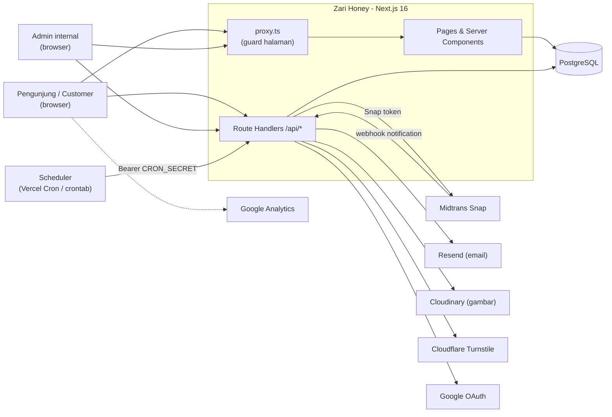
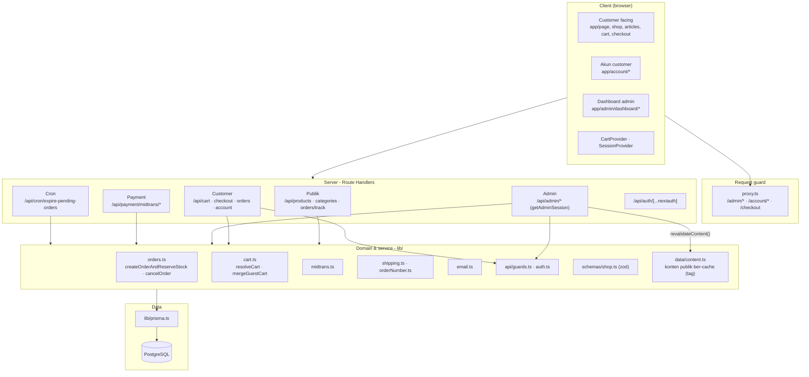
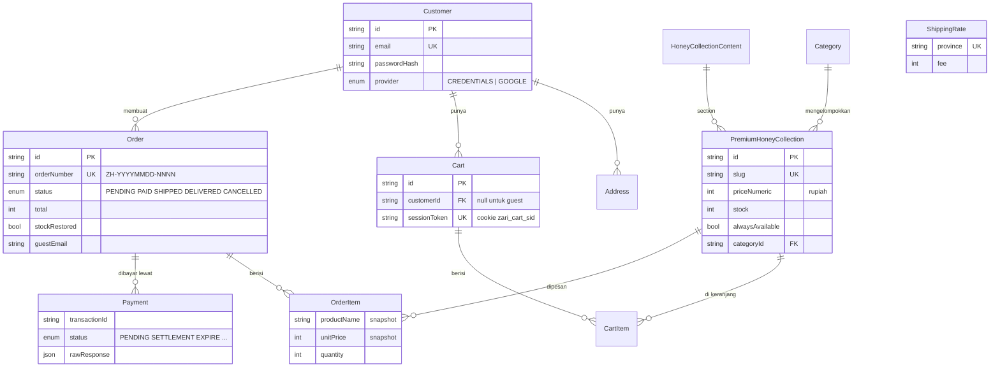
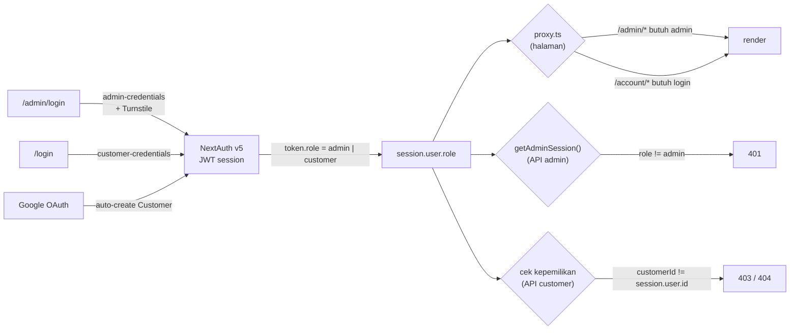

# Arsitektur — Zari Honey

Monolit **Next.js 16 App Router**: satu codebase melayani landing page, toko online, area akun
customer, dashboard admin, dan REST API. Data di PostgreSQL via Prisma.

## 1. Konteks sistem

## 2. Lapisan aplikasi

**Aturan dependensi**: `app/` → `lib/` → `lib/prisma.ts`. `components/` tidak mengimpor
`lib/prisma` (komponen client tidak boleh menyentuh DB). Komponen `components/ui/` tidak berisi
logika bisnis.

**Konten publik** (homepage, header, footer) dibaca di Server Component lewat getter
`lib/data/content.ts` (`unstable_cache` per tag + React `cache`, fallback ke `lib/constants.ts`),
lalu diteruskan sebagai props ke komponen animasi client. Route admin yang mengubah konten wajib
memanggil `revalidateContent(CONTENT_TAGS.<x>)`; homepage juga revalidate tiap 1 jam.
`/articles` dan `/articles/[slug]` memakai pola yang sama (ISR + `generateStaticParams`).
`/shop` dirender dinamis dari `searchParams` lewat `lib/data/products.ts` — tidak di-cache karena
menampilkan stok terkini.

## 3. Model data

Tabel CMS berdiri sendiri (tanpa relasi), satu baris per section dengan kolom `Json`:
`HeroContent`, `AboutContent`, `WhyChooseContent`, `TestimonialContent`, `PartnershipContent`,
`ArticleContent`, `Settings`. Tabel `Admin` terpisah dari `Customer`.

Tabel `RateLimit` (`rate_limits`) berdiri sendiri: counter fixed-window per kunci (`<aturan>:<ip>[:<email>]`), ditulis atomik oleh `lib/rate-limit.ts`.

## 4. Autentikasi & otorisasi

`proxy.ts` **tidak** melindungi `/api/*`. Setiap route handler harus melakukan cek sendiri.

## 5. Keputusan arsitektur & arah ke depan

| Topik | Saat ini | Target (lihat TECH-DEBT) |
|---|---|---|
| Data konten publik | Fetch client-side ke `/api/admin/*` | Server Component + cache bertag (TD-10) |
| Konten CMS | Blob JSON per section | Tabel per entitas (TD-17) |
| Konsistensi stok/order | Update bersyarat + transaksi (`cancelOrder`) | Dipertahankan; tambah incident table (TD-15) |
| Upload gambar | Cloudinary + disk lokal | Cloudinary saja (TD-09) |
| Konfigurasi | `process.env` tersebar | `lib/env.ts` tervalidasi (TD-22) |
| Observability | `console.*` | Sentry + log terstruktur (TD-28) |
