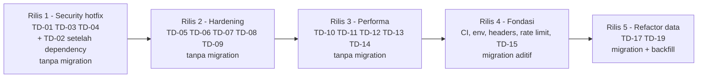
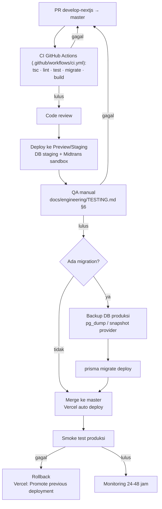
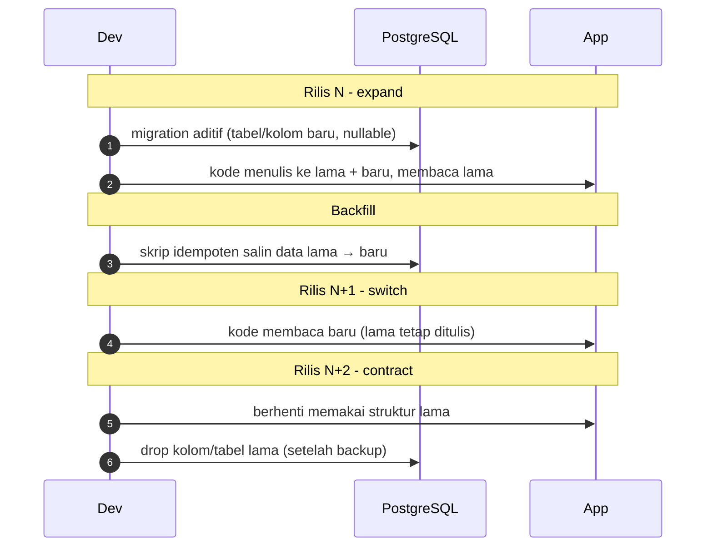

# Deployment Plan — Zari Honey

Rilis bertahap sesuai roadmap di [TECH-DEBT.md](./TECH-DEBT.md). Target hosting utama: **Vercel**
(sesuai `docs/DEPLOYMENT.md`), dengan alternatif VPS + PM2. Branch kerja `develop-nextjs`, branch
produksi `master`.

## 1. Gelombang rilis



| Rilis | Isi | Migration | Risiko | Downtime |
|---|---|---|---|---|
| 1 | Guard admin, stok atomik, cancel atomik, (sanitize HTML) | Tidak | Rendah | Tidak |
| 2 | Webhook nominal + `after()`, escape email, zona waktu WIB, hapus upload lokal | Tidak | Rendah | Tidak |
| 3 | Data layer server + cache, ISR | Tidak | Sedang (perilaku cache) | Tidak |
| 4 | CI, `lib/env.ts`, security headers, rate limit, incident pembayaran | Aditif (kolom/tabel baru) | Sedang (CSP bisa memblokir script) | Tidak |
| 5 | Tabel Article/Testimonial/Partner, konsolidasi harga produk | Ya + backfill | Tinggi | Tidak (expand → migrate → contract) |

## 2. Alur deploy (setiap rilis)



## 3. Rilis 1 — checklist detail

### Pre-deploy
- [ ] `npx tsc --noEmit`, `pnpm lint`, `pnpm test` lulus (status 2026-11-19: ✅ 254/254).
- [ ] `pnpm build` lulus.
- [x] TD-02: `sanitize-html` terpasang, test sanitizer lulus.
- [ ] Jalankan cek data (read-only) terhadap DB produksi:
      `pnpm tsx scripts/check-order-integrity.ts` — atau query manual di bawah via `psql "$DATABASE_URL"`.
- [ ] Cek stok negatif di produksi:
      `SELECT id, name, stock FROM premium_honey_collections WHERE stock < 0;` → koreksi manual.
- [ ] Cek order PENDING yang punya Payment SETTLEMENT (korban bug lama):
      `SELECT o."orderNumber", o.status FROM orders o JOIN payments p ON p."orderId" = o.id WHERE o.status NOT IN ('PAID','SHIPPED','DELIVERED') AND p.status = 'SETTLEMENT';`
- [ ] Tidak ada perubahan environment variable.

### Staging
- [ ] QA-01 s/d QA-10 (`TESTING.md` §6).
- [ ] Notifikasi Midtrans sandbox diarahkan ke URL staging.

### Deploy
1. Merge PR ke `master` di luar jam ramai (mis. 22:00–06:00 WIB).
2. Vercel otomatis build & deploy. VPS: `git pull && pnpm install --frozen-lockfile && pnpm build && pm2 reload zari-madu`.
3. Tidak perlu `prisma migrate deploy`.

### Smoke test produksi (± 15 menit)
- [ ] Homepage, `/shop`, detail produk, artikel tampil normal.
- [ ] Login admin → edit settings → tersimpan.
- [ ] Login customer → `PUT /api/admin/settings` → 401.
- [ ] Tambah ke keranjang & checkout sampai popup Snap muncul (batalkan, atau bayar nominal kecil).
- [ ] Panggil cron manual dengan secret → 200.

### Monitoring 48 jam
- [ ] Log error `[/api/checkout POST]`, `[/api/payment/midtrans/notification POST]`.
- [ ] Log `[midtrans-webhook] PAID_AFTER_CANCEL` → tindak lanjut manual.
- [ ] Jumlah respons 401 dari `/api/admin/*` (lonjakan dari akun admin = indikasi masalah role).
- [ ] Jumlah 409 checkout (normal hanya saat stok habis).

### Rollback
- Vercel: **Deployments → deployment sebelumnya → Promote to Production** (± 1 menit).
- VPS: `git checkout <commit-sebelumnya> && pnpm build && pm2 reload zari-madu`.
- Aman dilakukan kapan saja: rilis 1 tidak mengubah schema maupun format data.

## 4. Konfigurasi cron (prasyarat)

Endpoint `POST /api/cron/expire-pending-orders` belum terjadwal di repo (tidak ada `vercel.json`).
Dicatat sebagai **TD-35** dan ditunda; selama belum dijadwalkan, order PENDING tidak pernah
kedaluwarsa otomatis (bisa dipicu manual dengan `curl` di bawah).

**Vercel** — Vercel Cron memanggil dengan `GET`, sedangkan endpoint hanya menerima `POST`. Pilihan:
tambahkan handler `GET` yang memanggil logika yang sama (Vercel mengirim header
`Authorization: Bearer $CRON_SECRET`), lalu:

```json
{ "crons": [{ "path": "/api/cron/expire-pending-orders", "schedule": "0 * * * *" }] }
```

**VPS** — crontab:

```cron
0 * * * * curl -fsS -X POST -H "Authorization: Bearer $CRON_SECRET" https://<domain>/api/cron/expire-pending-orders
```

## 5. Strategi migration untuk Rilis 4–5 (expand → migrate → contract)



Aturan: tidak pernah mengubah migration yang sudah ter-apply; selalu `prisma migrate deploy`
(bukan `db push`) di produksi; backup sebelum setiap migration.
