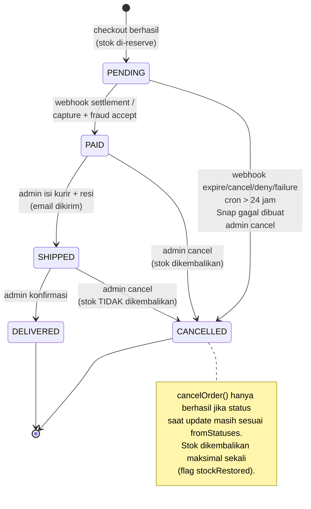
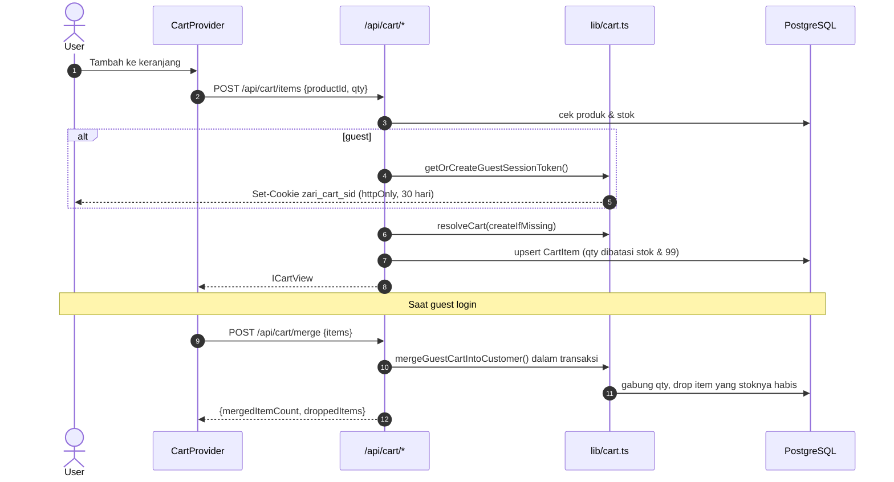
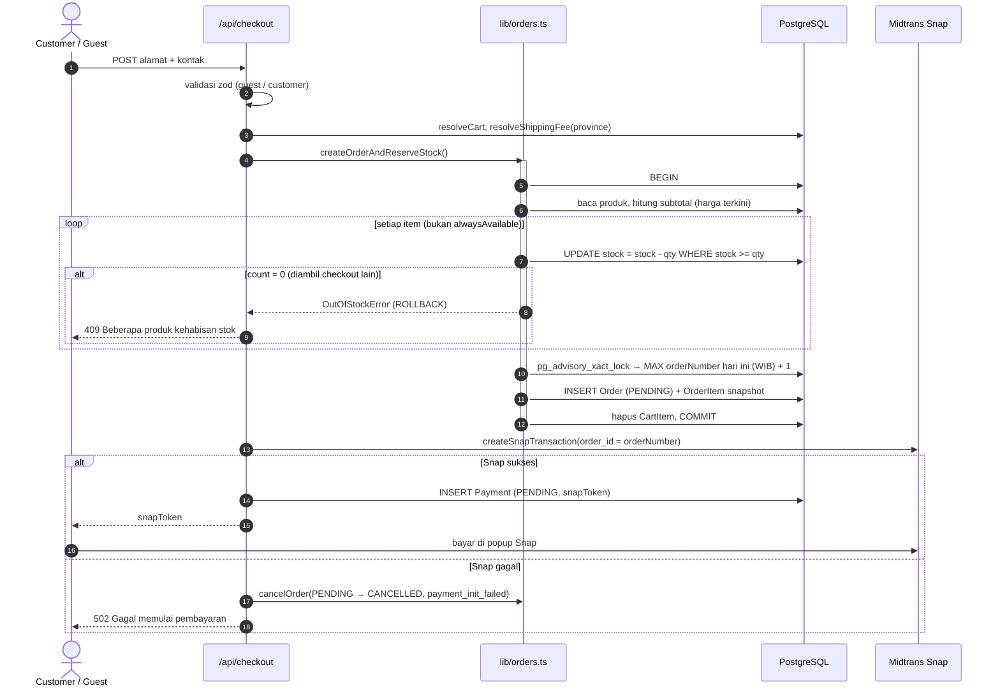
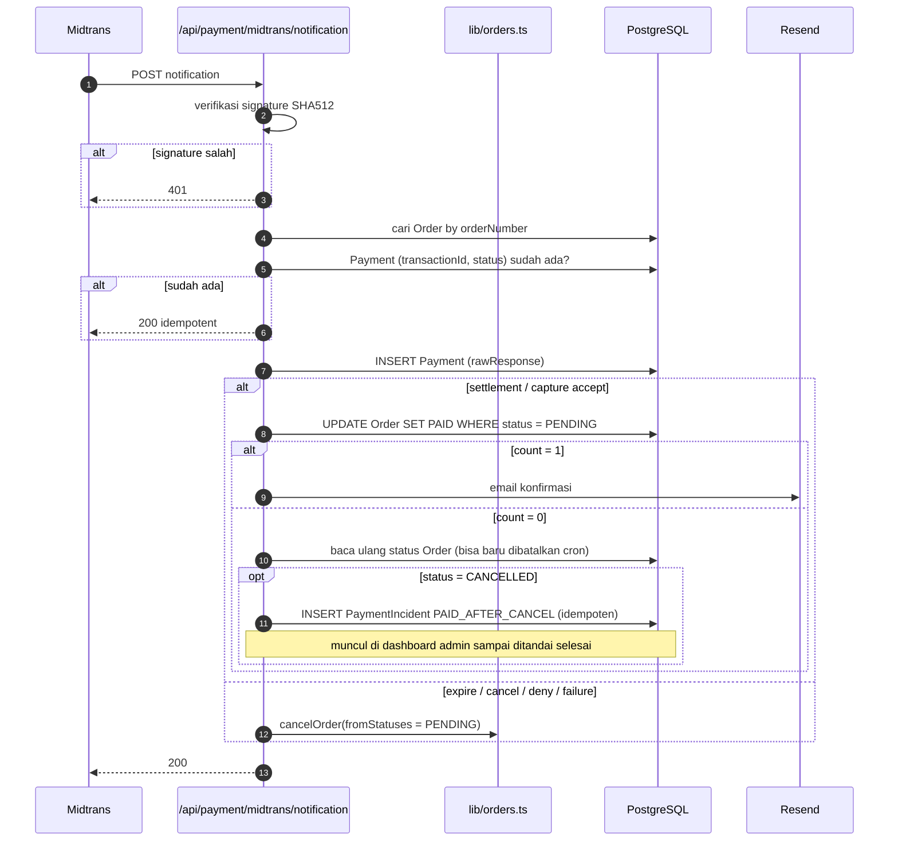
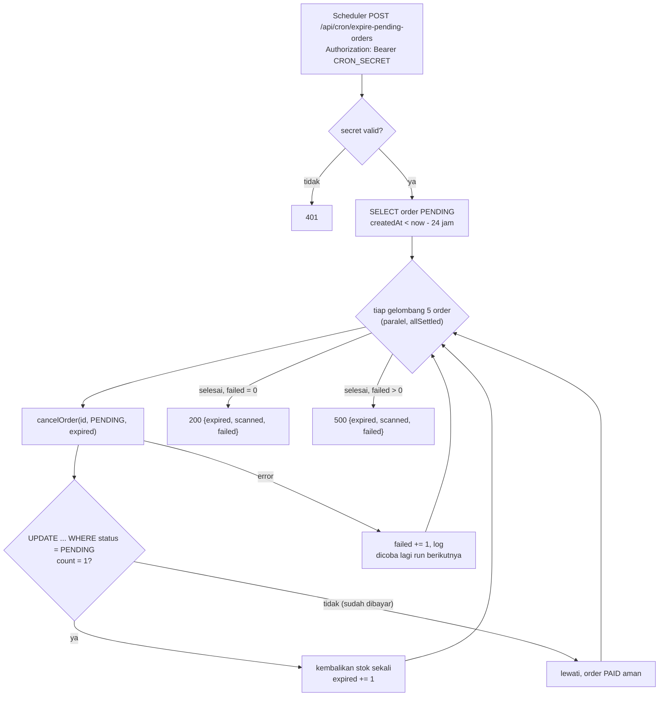
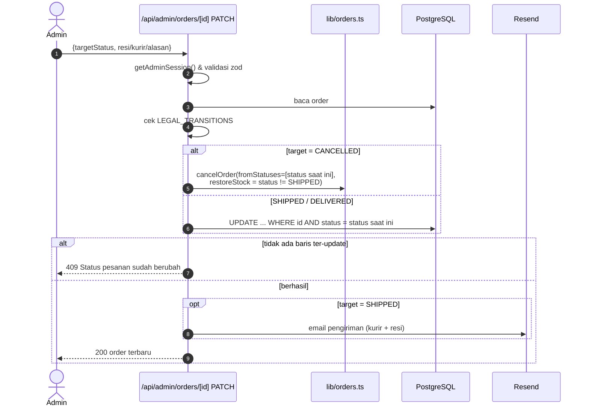
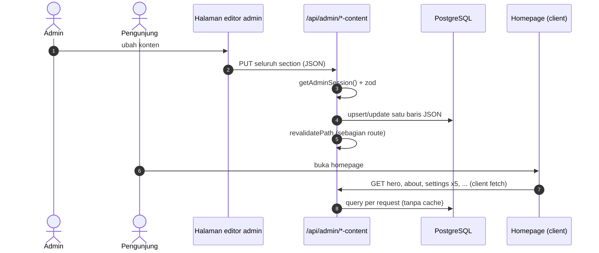

# Flow Bisnis — Zari Honey

Semua diagram mencerminkan kode setelah perbaikan P0 (2026-11-19).

## 1. State machine order

## 2. Keranjang (guest & customer)

## 3. Checkout & pembayaran

## 4. Webhook Midtrans

## 5. Cron kedaluwarsa order

## 6. Pemrosesan order oleh admin

## 7. Update konten CMS (kondisi saat ini)

> Target TD-10: homepage membaca data di server lewat fungsi ber-cache, dan `PUT` memanggil
> `revalidateTag(section)`, sehingga pengunjung tidak lagi memanggil `/api/admin/*`.
