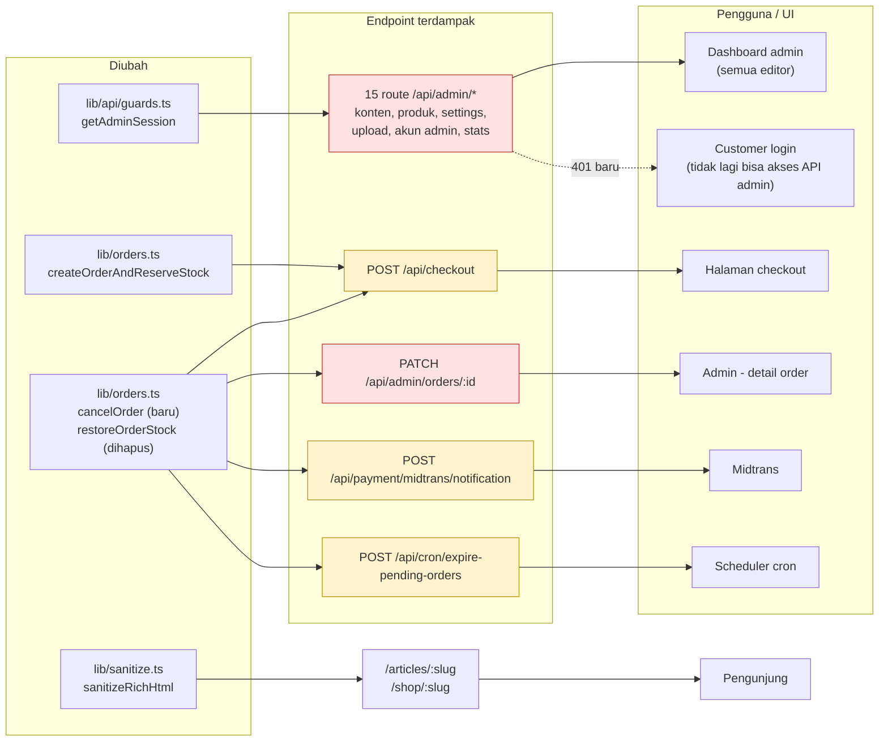
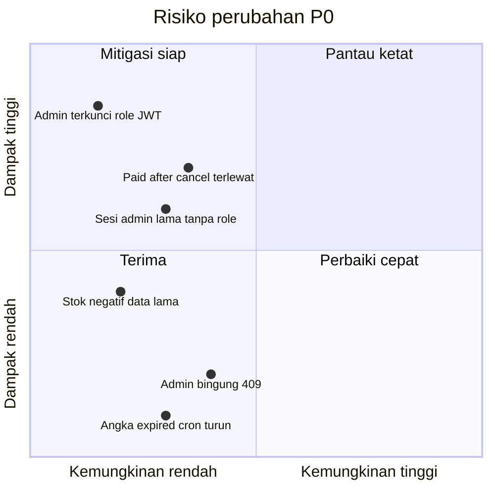

# Impact Analysis — Perbaikan P0 (TD-01, TD-02, TD-03, TD-04)

Tanggal: 2026-11-19 · Branch: `develop-nextjs` · Tanpa perubahan schema/migration database.

## 1. Ringkasan perubahan

| ID | Perubahan | File |
|---|---|---|
| TD-01 | Helper `getAdminSession()`; 15 route admin memakai guard role | `lib/api/guards.ts` (baru), `app/api/admin/**/route.ts` (15 file) |
| TD-02 | `sanitizeRichHtml()` sebelum render HTML artikel & deskripsi produk; dependency baru `sanitize-html` | `lib/sanitize.ts` (baru), `app/articles/[slug]/page.tsx`, `app/shop/[slug]/page.tsx`, `package.json` |
| TD-03 | Decrement stok bersyarat `stock >= qty` | `lib/orders.ts` |
| TD-04 | `cancelOrder()` atomik menggantikan `restoreOrderStock()`; update status bersyarat di webhook & admin | `lib/orders.ts`, `app/api/checkout/route.ts`, `app/api/cron/expire-pending-orders/route.ts`, `app/api/payment/midtrans/notification/route.ts`, `app/api/admin/orders/[id]/route.ts` |

## 2. Peta dampak

## 3. Perubahan perilaku yang terlihat

| Area | Sebelum | Sesudah | Siapa terdampak |
|---|---|---|---|
| API admin (PUT/POST/DELETE konten, produk, settings, upload, dashboard-stats, get-email, change-email/password) | Customer login bisa memanggil | Customer → **401** | Customer (seharusnya tidak pernah akses); admin tidak berubah |
| GET konten publik (`hero-content`, `settings`, dll.) | Publik | Tetap publik | Homepage tidak terdampak |
| Render artikel & deskripsi produk | HTML mentah | Tag/atribut di luar allowlist Tiptap dibuang (script, iframe, event handler, CSS selain color/background-color/text-align) | Pengunjung; konten yang ditempel manual dengan HTML/CSS khusus bisa kehilangan styling |
| Checkout paralel stok terakhir | Keduanya sukses, stok negatif | Yang kalah dapat **409** "Beberapa produk kehabisan stok" | Customer (perilaku benar) |
| Cron expire | Menimpa status apa pun yang ada di daftar | Hanya membatalkan yang masih PENDING; `expired` bisa < `scanned` | Laporan cron |
| Webhook PAID untuk order CANCELLED | Diabaikan diam-diam | Tetap diabaikan, tapi log `PAID_AFTER_CANCEL` | Tim ops (perlu cek log) |
| Webhook PAID ganda/paralel | Bisa kirim email 2× | Email sekali | Customer |
| Admin ubah status saat status sudah berubah | Menimpa | **409** "Status pesanan sudah berubah..." | Admin (perlu refresh) |
| Restore stok | Bisa terjadi untuk order yang ternyata PAID; bisa dobel saat paralel | Hanya untuk CANCELLED, tepat sekali | Akurasi stok |

## 4. Risiko & mitigasi

| Risiko | Mitigasi |
|---|---|
| Admin terkunci karena `role` tidak ada di JWT | `role` sudah di-set di callback `jwt` sejak login admin (`lib/auth.ts`); route categories/orders/shipping-rates sudah memakai cek yang sama dan berjalan di production. QA-02 sebelum rilis. Jika terjadi: admin logout/login ulang. |
| Sesi admin sangat lama (token dibuat sebelum role ditambahkan) | Logout & login ulang. |
| Pembayaran masuk untuk order yang sudah batal | Pantau log `PAID_AFTER_CANCEL` setelah rilis; tindak lanjut manual (kirim barang atau refund di dashboard Midtrans). Permanen: TD-15. |
| Styling artikel/produk lama hilang karena di luar allowlist | Cek visual beberapa artikel & produk di staging; tambah tag/atribut ke `lib/sanitize.ts` bila memang dibutuhkan (jangan `script`/`iframe`/`on*`). |
| Data stok lama sudah negatif akibat bug sebelumnya | Query cek sebelum rilis: `SELECT id, name, stock FROM premium_honey_collections WHERE stock < 0;` lalu koreksi manual. |
| Perilaku `updateMany` di Postgres berbeda dari mock | QA-04, QA-05, QA-08 di staging dengan DB sungguhan. |

## 5. Yang tidak berubah

- Schema Prisma & migration — **tidak ada migration**. Satu dependency runtime baru: `sanitize-html` (server-only).
- Kontrak response sukses semua endpoint.
- Alur UI customer & admin (kecuali pesan error baru di atas).
- Integrasi Midtrans (payload Snap, verifikasi signature).
