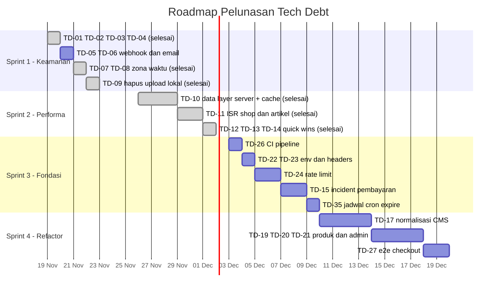

# Tech Debt Register — Zari Honey

> Hasil scan codebase 2026-11-19 (branch `develop-nextjs`). Integrasi agregator bank dan
> biometrik di luar scope. Baseline saat scan: `tsc` bersih, 213/213 test lulus,
> ESLint 0 error / 45 warning.

**Severity**: 🔴 Critical (celah keamanan / data rusak) · 🟠 High (bug nyata / performa signifikan)
· 🟡 Medium (maintainability / scalability) · ⚪ Low (kebersihan).
**Effort**: S ≤ ½ hari · M 1–3 hari · L > 3 hari.

## Ringkasan

| Severity | Jumlah | Selesai |
|---|---|---|
| 🔴 Critical | 6 | 4 |
| 🟠 High | 11 | 8 |
| 🟡 Medium | 12 | 0 |
| ⚪ Low | 6 | 0 |

## 🔴 Critical — keamanan & integritas data

| ID | Masalah | Lokasi | Dampak | Perbaikan | Effort | Status |
|---|---|---|---|---|---|---|
| TD-01 | 15 endpoint `/api/admin/*` hanya cek `session`, bukan `role === "admin"`. Registrasi customer terbuka. | `app/api/admin/{settings,hero-content,honey-collection,articles-content,...}/route.ts` | Customer bisa mengubah harga/stok produk, mengganti nomor WhatsApp toko, melihat omzet, upload file. | Helper `getAdminSession()` di `lib/api/guards.ts`, dipakai di semua route admin. | S | ✅ Selesai |
| TD-02 | Stored XSS: HTML artikel & deskripsi produk dirender mentah. | `app/articles/[slug]/page.tsx:133`, `components/shop/ProductDetail.tsx:74` | Script jahat jalan di browser semua pengunjung & admin. Diperparah TD-01. | `sanitizeRichHtml()` (`lib/sanitize.ts`, allowlist sesuai output Tiptap) dipanggil di server sebelum render. | S | ✅ Selesai |
| TD-03 | Stok dicek lalu dikurangi tanpa kondisi → oversell saat checkout paralel. | `lib/orders.ts` (`createOrderAndReserveStock`) | Stok negatif, order tidak bisa dipenuhi. | `updateMany({ where: { stock: { gte: qty } } })` + cek `count`. | S | ✅ Selesai |
| TD-04 | Pembatalan order tidak atomik (cron, webhook, admin, checkout). Cron bisa menimpa order PAID jadi CANCELLED; stok order PAID bisa dikembalikan. | `app/api/cron/expire-pending-orders`, `lib/orders.ts`, webhook, admin PATCH | Customer sudah bayar tapi order batal; stok ganda. | `cancelOrder()` atomik bersyarat status + klaim `stockRestored`. Transisi admin bersyarat (409 jika berubah). | M | ✅ Selesai |
| TD-05 | Webhook tidak mencocokkan `gross_amount` dengan `order.total`; signature dibandingkan dengan `===`; email dikirim sinkron. | `app/api/payment/midtrans/notification/route.ts`, `lib/midtrans.ts` | Mismatch nominal tidak terdeteksi; timing attack (teoritis); webhook lambat → retry Midtrans. | Validasi nominal, `timingSafeEqual`, `after()` untuk email. Set `expiry` Snap < TTL order. | S | ⬜ |
| TD-06 | HTML injection di template email (nama/alamat dari user tidak di-escape). | `lib/email.ts:25,40` | Phishing lewat email resmi toko. | Fungsi `escapeHtml` untuk semua nilai dinamis. | S | ⬜ |

## 🟠 High — bug & performa

| ID | Masalah | Lokasi | Perbaikan | Effort | Status |
|---|---|---|---|---|---|
| TD-07 | Nomor order memakai jam server (UTC di Vercel) dan sequence berbasis `count` → tanggal salah 00:00–07:00 WIB, bentrok saat ramai (P2002 → checkout 500). | `lib/orderNumber.ts` | Prefix tanggal via `Intl` zona `Asia/Jakarta`; sequence = `MAX(orderNumber)` hari itu + 1 di dalam transaksi order, diserialkan `pg_advisory_xact_lock` (tanpa migration). | S | ✅ Selesai |
| TD-08 | Omzet bulanan dihitung dengan zona waktu server. | `app/api/admin/dashboard-stats/route.ts` | Batas bulan dalam WIB via `jakartaMonthRange()` (`lib/datetime.ts`, dipakai juga oleh nomor order). | S | ✅ Selesai |
| TD-09 | Upload ke `public/uploads` (filesystem read-only di serverless), duplikat dengan route Cloudinary. | `app/api/admin/upload/route.ts` | Hapus route, pakai Cloudinary saja. Route & dependency `sharp` dihapus (`next` tetap membawa `sharp` opsional untuk `next/image`). | S | ✅ Selesai |
| TD-10 | Homepage: semua section `"use client"` + ~11 fetch client ke `/api/admin/*`; `/api/admin/settings` di-fetch 5×. Konten tidak terindeks Google, LCP lambat. | `components/*Section.tsx`, `Header.tsx`, `Footer.tsx` | Data layer server `lib/data/*` dengan `unstable_cache`/`"use cache"` + `revalidateTag`; komponen animasi menerima props. Selesai: `lib/data/content.ts` (`unstable_cache` + tag, `revalidateContent()` di semua route admin konten), `Header`/`Footer` jadi Server Component, homepage statis + revalidate 1 jam. | M | ✅ Selesai |
| TD-11 | `force-dynamic` + `revalidate = 0` di `/shop`, `/articles`, `/articles/[slug]`; listing produk dimuat client-side. | `app/shop/page.tsx`, `app/articles/**` | ISR + revalidate on-demand; render listing awal di server. Selesai: `/articles` & `/articles/[slug]` ISR (revalidate 1 jam + tag `content:articles`, `generateStaticParams`); `/shop` render listing di server dari `searchParams` via `lib/data/products.ts` (`<Suspense key>` per filter), tetap dinamis tanpa cache karena menampilkan stok. | M | ✅ Selesai |
| TD-12 | `DashboardWrapper` polling localStorage setiap 100 ms. | `components/admin/DashboardWrapper.tsx:37` | React context untuk state sidebar. Selesai: hook `useSidebarExpanded` (`useSyncExternalStore` + localStorage) dipegang `DashboardWrapper`, diteruskan ke `AdminSidebar` lewat props — polling dihapus. | S | ✅ Selesai |
| TD-13 | `LoadingProgress` progress bar palsu 1 detik di homepage. | `components/LoadingProgress.tsx` | Hapus. Selesai: komponen dihapus dari homepage; loading admin koleksi madu memakai spinner yang sama dengan halaman admin lain. | S | ✅ Selesai |
| TD-14 | Query berurutan / N+1: dashboard-stats (6 query serial), merge cart, cron loop. | beberapa | `Promise.all`, batch query. Selesai: dashboard-stats 6 query via `Promise.all`; merge cart 1 `findMany` + 1 `createMany` (entri duplikat digabung); cron membatalkan paralel maks 5 dengan `allSettled` (gagal → 500 + `failed`), restore stok urut `productId` agar tidak deadlock. | S | ✅ Selesai |
| TD-15 | Webhook PAID setelah order CANCELLED hanya di-log (`PAID_AFTER_CANCEL`), belum ada flag/alert di dashboard. | webhook | Kolom `needsReview` / tabel `PaymentIncident` + badge di admin. | M | ⬜ |
| TD-16 | `/api/products`: jika `page > totalPages`, metadata bilang page 1 tapi `items` kosong. | `app/api/products/route.ts` | Hitung `safePage` sebelum query. | S | ⬜ |
| TD-35 | Cron `expire-pending-orders` belum dijadwalkan (tidak ada `vercel.json`/crontab). Order PENDING yang tidak dibayar tidak pernah kedaluwarsa, stoknya tertahan selamanya. Endpoint hanya menerima `POST`, sedangkan Vercel Cron memanggil `GET`. | `app/api/cron/expire-pending-orders/route.ts` | Tambah handler `GET` (logika sama, auth `Bearer CRON_SECRET`), daftarkan jadwal per jam; lihat DEPLOYMENT-PLAN §4. Ditunda sesuai keputusan 2026-11-19. | S | ⬜ |

## 🟡 Medium — maintainability & scalability

| ID | Masalah | Perbaikan | Effort |
|---|---|---|---|
| TD-17 | Konten CMS (artikel, testimoni, partnership) disimpan sebagai satu array JSON per baris → lost update antar admin, tanpa paginasi, lookup artikel memuat semua. | Tabel `Article`, `Testimonial`, `Partner` + migrasi data. | L |
| TD-18 | Pola singleton tidak konsisten (`id: "default"` vs `findFirst orderBy updatedAt`); GET ikut membuat baris (write on read). | Seed sekali, GET read-only. | S |
| TD-19 | Produk: dua sumber harga (`price` String + `priceNumeric`), nama model `PremiumHoneyCollection`, tanpa `isActive`/soft-delete, CRUD tanpa zod. | Konsolidasi harga, zod schema, rename bertahap. | M |
| TD-20 | Duplikasi: mapper `toOrderView` (webhook & admin inline), helper `JSON.parse` di tiap route konten, guard auth admin lama di categories/orders/shipping-rates. | `lib/mappers/order.ts`, `lib/content.ts`, pakai `getAdminSession` di semua route. | S |
| TD-21 | Halaman admin 500–950 baris (`articles/page.tsx` 952). | Pecah ke komponen form + hook data. | M |
| TD-22 | Tidak ada validasi env terpusat; Turnstile *fail-open* bila belum dikonfigurasi di production. | `lib/env.ts` (zod), fail-closed di production. | S |
| TD-23 | Tidak ada security headers (CSP, HSTS, frame-ancestors). | `headers()` di `next.config.ts`. | S |
| TD-24 | Tidak ada rate limit (login, register, track order, retry, checkout); login customer tanpa captcha. | Rate limiter (Upstash/Redis atau tabel DB). | M |
| TD-25 | Role di JWT tidak dicek ulang ke DB; ganti password tidak menginvalidasi sesi lama. | `tokenVersion` di Admin/Customer, cek di callback `jwt`. | M |
| TD-26 | Tidak ada CI (tsc + lint + test + build). | Pipeline GitLab CI. | S |
| TD-27 | Tidak ada e2e test alur checkout. | Playwright: browse → cart → checkout (Midtrans sandbox). | M |
| TD-28 | Tidak ada error monitoring / log terstruktur. | Sentry + logger JSON. | S |

## ⚪ Low — kebersihan repo

| ID | Masalah | Perbaikan |
|---|---|---|
| TD-29 | `logs/` ter-commit. | Tambah ke `.gitignore`, `git rm --cached`. |
| TD-30 | 24 dokumen di `docs/` banyak yang usang/duplikat (`QUICK-START` vs `QUICKSTART`, beberapa "COMPLETE"). | Arsipkan ke `docs/archive/`. |
| TD-31 | 45 ESLint warning (unused vars di seed, `window.location.assign`, dll.). | Bersihkan bertahap. |
| TD-32 | Placeholder `verification.google: "your-google-verification-code"`. | Isi atau hapus. |
| TD-33 | Nomor WhatsApp & domain di-hardcode di beberapa tempat (`zarihoney.com` vs `zarilife.com`). | Ambil dari Settings/env. |
| TD-34 | Test suite 141 detik (62 worker terisolasi, jsdom untuk semua). | Environment `node` untuk test API, `isolate: false` bila aman. |

## Roadmap

