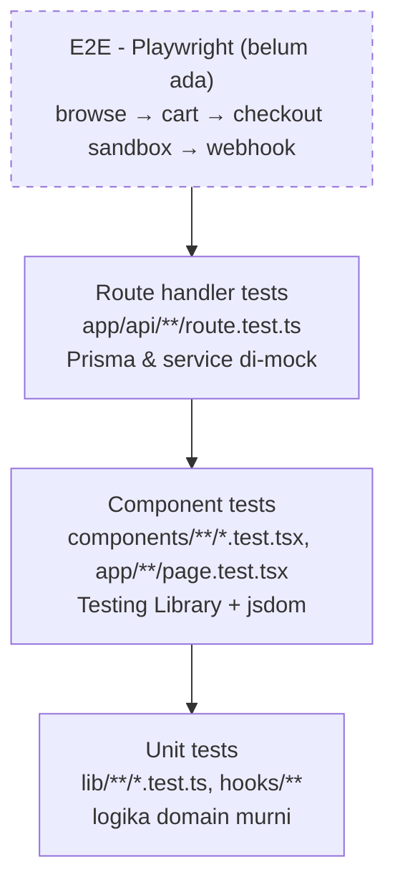

# Testing — Zari Honey

## 1. Status saat ini (2026-11-19)

| Cek | Hasil |
|---|---|
| `npx tsc --noEmit` | ✅ 0 error |
| `pnpm test` | ✅ 63 file, **254 test** lulus (sebelumnya 213) — ±2 menit |
| `pnpm lint` | ✅ 0 error, 45 warning (tidak ada warning baru) |
| E2E | ❌ belum ada |
| CI | ❌ belum ada |

## 2. Strategi



- **Unit (`lib/`)** — logika domain: perhitungan order, stok, mapping status Midtrans, schema zod.
  Prisma di-mock pada level `tx` agar kondisi `where` (mis. `stock: { gte }`) ikut diverifikasi.
- **Route handler** — status HTTP, otorisasi, dan pemanggilan service dengan argumen yang benar.
- **Komponen** — render, interaksi form, state cart.
- **E2E** (target) — satu happy path checkout + satu path gagal bayar per rilis.

## 3. Konvensi

- File test co-located: `foo.ts` ↔ `foo.test.ts`.
- Mock dibuat dengan `vi.hoisted` + `vi.mock("@/lib/...")`, reset di `beforeEach`.
- Setiap bug fix wajib disertai test yang **gagal di kode lama** dan lulus di kode baru.
- Nama test dalam bahasa Inggris, menjelaskan perilaku (`"returns 409 when the status changed concurrently"`).
- Jangan memanggil layanan eksternal sungguhan (Midtrans, Resend, Cloudinary) di unit/route test.

## 4. Menjalankan

```bash
pnpm test                                  # semua
pnpm test -- lib/orders                    # satu area
pnpm test -- app/api/admin/admin-auth      # regresi otorisasi admin
pnpm test:watch                            # mode watch
pnpm test -- --coverage                    # laporan coverage (v8)
```

## 5. Test yang ditambahkan untuk perbaikan P0

| Tech debt | File test | Skenario | Bukti regresi |
|---|---|---|---|
| TD-01 | `app/api/admin/admin-auth.test.ts` (baru) | 17 handler admin × {customer login, anonim} → 401 dan **tidak ada query DB** | Pada kode lama 17 kasus "customer" gagal |
| TD-02 | `lib/sanitize.test.ts` (baru) | `<script>`, `onerror=`, `javascript:`/`data:` URL, iframe/form/style, CSS berbahaya dibuang; format Tiptap (heading, list + class, warna, align, highlight) tetap; link `_blank` diberi `rel` aman | — |
| TD-03 | `lib/orders.test.ts` | Decrement memakai `stock >= qty`; checkout paralel mengambil stok duluan → `OutOfStockError`, order tidak dibuat | — |
| TD-04 | `lib/orders.test.ts` | `cancelOrder` tidak berbuat apa-apa jika status sudah berubah; stok dikembalikan sekali; tidak dikembalikan saat `restoreStock: false` | — |
| TD-04 | `app/api/cron/expire-pending-orders/route.test.ts` | Order yang dibayar di antara scan & cancel tidak dihitung expired | — |
| TD-04 | `app/api/payment/midtrans/notification/route.test.ts` | PENDING → PAID kirim email sekali; PAID untuk order CANCELLED tidak menghidupkan order & dicatat `PAID_AFTER_CANCEL` | — |
| TD-04 | `app/api/admin/orders/[id]/route.test.ts` | 409 jika status berubah bersamaan; cancel dari SHIPPED tanpa restore stok | — |
| TD-04 | `app/api/checkout/route.test.ts` | Gagal init Snap → `cancelOrder(PENDING, payment_init_failed)` | — |

## 6. Skenario QA manual (staging, Midtrans sandbox)

| # | Skenario | Langkah | Ekspektasi |
|---|---|---|---|
| QA-01 | Otorisasi admin | Login sebagai customer, panggil `PUT /api/admin/settings` via DevTools | 401, settings tidak berubah |
| QA-02 | Admin normal | Login admin, ubah hero/settings/produk | Tersimpan seperti biasa |
| QA-03 | Checkout guest | Tambah produk → checkout guest → bayar QRIS sandbox | Order PAID, email konfirmasi, stok berkurang |
| QA-04 | Oversell | Stok produk = 1; dua browser checkout bersamaan | Satu sukses, satu dapat 409 "kehabisan stok"; stok = 0 (tidak negatif) |
| QA-05 | Expire | Buat order, jangan bayar, panggil cron dengan `createdAt` dimundurkan (atau TTL staging diperkecil) | Order CANCELLED, stok kembali tepat sekali |
| QA-06 | Bayar setelah expire | Order CANCELLED oleh cron, lalu kirim notifikasi settlement sandbox | Order tetap CANCELLED, Payment tercatat, log `PAID_AFTER_CANCEL` |
| QA-07 | Admin kirim | Order PAID → SHIPPED dengan resi | Email pengiriman terkirim |
| QA-08 | Konflik admin | Dua tab admin memproses order yang sama | Tab kedua dapat pesan "Status pesanan sudah berubah" |
| QA-09 | Batal setelah kirim | Order SHIPPED → CANCELLED | Stok **tidak** bertambah |
| QA-10 | Notifikasi ganda | Kirim notifikasi settlement yang sama dua kali | Email hanya sekali, respons kedua `idempotent` |

## 7. Gap & rencana

1. **E2E Playwright** (TD-27) untuk QA-03 dan QA-04.
2. **CI** (TD-26): `tsc` → `lint` → `test` → `build` di setiap MR.
3. **Percepat suite** (TD-34): environment `node` untuk `app/api/**` dan `lib/**`, jsdom hanya untuk komponen.
4. Test integrasi DB sungguhan (Postgres di container) untuk query bersyarat stok/status, karena mock tidak membuktikan perilaku konkurensi Postgres.
5. QA visual artikel & deskripsi produk lama setelah sanitasi (pastikan format tidak hilang).
